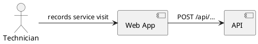

# arc42 documentation

The architecture documentation is an Astro Starlight site in `docs/`. Every
arc42 section is one page in `docs/src/content/docs/arc42/`:

| File                            | arc42 section                   | Typical trigger                          |
| ------------------------------- | ------------------------------- | ---------------------------------------- |
| `introduction-and-goals.mdx`    | 1 Introduction and Goals        | first story, new major feature           |
| `architecture-constraints.mdx`  | 2 Architecture Constraints      | workspace/stack constraints              |
| `system-scope-and-context.mdx`  | 3 System Scope and Context      | new user role or external system         |
| `solution-strategy.mdx`         | 4 Solution Strategy             | foundational decisions                   |
| `building-block-view.mdx`       | 5 Building Block View           | new project, module or major component   |
| `runtime-view.mdx`              | 6 Runtime View                  | important or non-obvious interaction     |
| `deployment-view.mdx`           | 7 Deployment View               | how and where the system runs            |
| `cross-cutting-concepts.mdx`    | 8 Cross-cutting Concepts        | validation, errors, persistence, testing |
| `architecture-decisions.mdx`    | 9 Architecture Decisions (ADRs) | every significant decision               |
| `quality-requirements.mdx`      | 10 Quality Requirements         | quality goals become measurable          |
| `risks-and-technical-depts.mdx` | 11 Risks and Technical Debt     | known shortcuts and risks                |
| `glossary.mdx`                  | 12 Glossary                     | new domain term                          |

## Writing a section

- The pages still contain the arc42 template text (`**Contents**`,
  `**Motivation**`, `**Form**` blocks). When you fill in a section, **replace**
  that guidance with real content; keep the headings and the link to
  docs.arc42.org at the end of each section so readers find the background.
- Leave a section's template text untouched until there is something real to
  say; do not write filler.
- Write for a developer who joins the team tomorrow: concrete, short, with names
  of real projects, endpoints and tables. Link to code with repository paths
  (e.g. `apps/<name>/…`).
- Use the domain terms from the glossary consistently; add new terms there.
- Keep the frontmatter `title` of each page; the sidebar is configured in
  `docs/astro.config.mjs`.

## Diagrams

Diagrams are written inline as PlantUML code blocks. The docs build turns each
block into an image URL on the public PlantUML server
(`docs/src/plugins/remark-plantuml.mjs`), so the diagram is rendered when the
page is viewed. Two consequences: the build does not catch PlantUML syntax
errors, and diagram content is sent to plantuml.com — keep it free of
confidential information.

````md

````

Use them for the context view (3), the building block view (5) and runtime
scenarios (6). Keep each diagram small enough to read without zooming.

## Architecture decision records

All ADRs live in `architecture-decisions.mdx`, newest last, numbered
consecutively. Replace the template text with an index table and append each ADR
as its own `###` heading:

```md
### ADR-003: Generate the TypeScript API client from OpenAPI

- **Status:** accepted
  (US-001) <!-- proposed | accepted | superseded by ADR-00x -->
- **Context:** Why a decision is needed; forces and constraints.
- **Decision:** What we do, stated in one or two sentences.
- **Consequences:** What becomes easier or harder; follow-up work.
```

- Never rewrite an accepted ADR. If a decision changes, add a new ADR and mark
  the old one as `superseded by ADR-00x`.
- Reference the story that triggered the decision.
- Record decisions that are hard to reverse or that the coder, tester or
  reviewer must know: stack and library choices, project boundaries, API style,
  persistence, error handling, testing strategy.

## Check

Run `pnpm nx build docs` after editing; it fails on broken Markdown/MDX and
frontmatter. To check a diagram, open its generated image URL (or the page via
`pnpm nx dev docs`) — the build cannot validate PlantUML.
